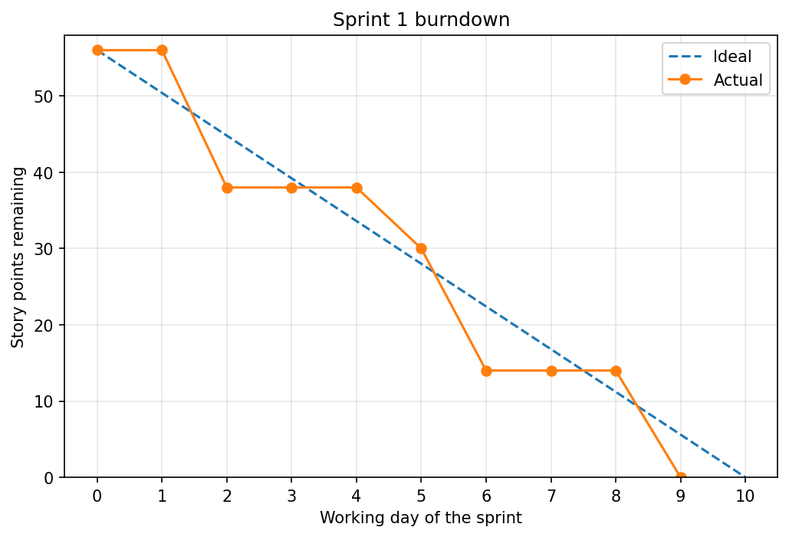

# CodeGauge

A static code review tool for Python that measures complexity, flags quality issues and
scores source files.

CO7095 Software Measurement and Quality Assurance, 2026-27 Semester 1 — group assignment,
project **#17, Software Code Review Tool**.

> **This README grows with the project.** Each phase adds a section; the
> [update schedule](#readme-update-schedule) at the bottom says what to add when. Keep it
> current — it is the first thing the marker reads, and the brief requires a detailed
> README for the code marks.

---

## Status

| Phase | Dates | State |
|---|---|---|
| Sprint 0 — design and planning | 4–7 Nov 2026 | **complete** |
| Sprint 1 | 9–22 Nov 2026 | **complete** — 12 of 12 stories, 56 of 56 points |
| Sprint 2 | 23 Nov–6 Dec 2026 | not started |
| Sprint 3 | 7–20 Dec 2026 | not started |
| Hardening | 21–27 Dec 2026 | not started |
| Report, video, packaging | 28 Dec–3 Jan 2027 | not started |
| Submitted | 4 Jan 2027 | not started |

**User stories:** 12 of 36 done · 56 of 196 story points · **Sprint 1 complete**
**Tests:** 492 passing · **Coverage:** 100% of `core/`, 99% overall

*As of 20 November 2026. Velocity 56, nothing carried over. CPI 1.70, SPI 1.00 — the
sprint delivered exactly what it committed, on time, in 40% fewer hours than budgeted.
Sprint 2 begins 23 November.*

<!-- PHASE: update this table and these two lines at every sprint review. -->

## What it does

CodeGauge reviews Python source files without running them. It reduces each function to a
set of measurements — length, parameters, nesting depth, decision points, duplication —
then applies configurable quality rules, grades each finding by how far past its limit it
has gone, and reports a quality score out of 100 with a letter grade. Reviews are kept in a
history file so a file's quality can be tracked over time.

Backend only, by design: a text menu is the entire front end and the history lives in a
serialised text file. **No GUI, no database, no third-party runtime dependencies, and no
use of the `ast` module** — analysis is line-based, using only techniques taught in the
module.

## Team

| Member | Student number | Username | GitHub | Slice | Stories | Points |
|---|---|---|---|---|---|---|
| Gunjan | 259059915 | `gsk17` | `gsk17` | scanning and line metrics | US01–US04, US06–US09, US36 | 46 |
| Kasam | 259059933 | `khm12` | `kasam-leicester` | complexity metrics | US10, US12–US18, US20 | 55 |
| Saaket | 269046020 | `ssl21` | `saaket-ssl` | rule engine and severity | US11, US19, US21–US27 | 47 |
| Harshita | 269035432 | `hcg22` | `guduru0112` | scoring, history and persistence | US05, US28–US35 | 48 |

Each member owns a vertical slice, because the testing and research marks are assessed
individually. The story numbers are not contiguous: after planning poker the per-member
totals were uneven, so two same-sprint swaps were made to bring them closer together — US05 ↔ US36 and US20 ↔ US11. Ownership is therefore per
function, not per module.

**Repository:** https://github.com/gsk17/CodeGauge-SoftwareCodeReviewTool
**Collaborators:** `<add the Professor's and every TA's GitHub ID>`

<!-- PHASE 1: fill in usernames, GitHub handles, the repository URL and the collaborators. -->

## Requirements

- Python 3.9 or newer (developed on 3.11). Standard library only at runtime.
- PyCharm — the project is developed and marked in PyCharm.
- For the tests: `python -m pip install --user pytest coverage`

## Running it

```bash
python main.py
```

Right now this prints the banner only; the menu is wired in by the CLI story in Sprint 3.

## Running the tests

```bash
python -m pytest -v
python -m coverage run -m pytest && python -m coverage report -m
```

<!-- PHASE 1: add the per-technique commands once the test packages exist:
       python -m pytest <username>/test/blackbox/<technique> -v
     PHASE 5: add one line per member per technique, which the brief requires. -->

## Layout

```
main.py                 entry point
model/                  FunctionRecord, Issue, ReviewReport, Thresholds
cli/                    text menu and report formatter       (Sprint 3)
core/                   scanner, metrics, rules, scoring     (Sprints 1-3)
tests/                  shared tests for the data model
gsk17/test/             Gunjan - black-box and white-box test packages
khm12/test/             Kasam
ssl21/test/             Saaket
hcg22/test/             Harshita
docs/                   design, Scrum, measurement, CMMI, symbolic, report
```

<!-- PHASE: extend as modules land. The final version lists every module with its owner. -->

## Documentation

| Document | Contents |
|---|---|
| [docs/design/](docs/design/) | design specification: goals, approaches considered, architecture |
| [docs/scrum/](docs/scrum/) | product backlog, sprint backlogs, Definition of Done, sprint notes |
| [docs/measurement/](docs/measurement/) | PERT and critical path, COCOMO I and II, EVM, burndown, velocity, planning poker |
| [docs/cmmi/level2-audit.md](docs/cmmi/level2-audit.md) | CMMI Level 2 audit and configuration management |
| [docs/symbolic/](docs/symbolic/) | symbolic execution and concolic testing analyses |

## Process

Three two-week Scrum sprints, 9 November to 20 December 2026. Sprint 0 produced the design,
the backlog and the estimates — see [sprint-0-notes.md](docs/scrum/sprint-0-notes.md), which
also records the throwaway prototype that was built to size the work and then discarded,
and why.

One branch per user story, `feature/<username>-us<NN>-<slug>`, merged by reviewed pull
request and **never deleted** — the brief requires branches as development evidence.

## Progress

### Sprint 1 burndown



Ideal against actual, 56 points over 10 working days. The chart is generated from
[burndown-data.csv](docs/measurement/burndown-data.csv), which is appended at each daily
stand-up rather than filled in at the end of the sprint:

```bash
python docs/measurement/scripts/burndown.py 1
```

The image above is always the latest run. A dated copy is kept after each stand-up in
[docs/measurement/charts/](docs/measurement/charts/) — a single final chart cannot show
whether the line was recorded daily or drawn at the end of the sprint, and the snapshots
are what settle that.

The actual line is a staircase rather than a slope, and deliberately so. Stories are worth
3, 5 or 8 points and the 0/100 rule pays nothing until a story merges, so the line cannot
track a 5.6-points-per-day ideal — it holds flat for days and then drops when a batch of
pull requests lands. Day 2 fell 18 points in one afternoon when four members merged
together.

Two gaps in the line are worth reading rather than smoothing over:

- **Day 4, Friday 13 November** — no work on any branch. The day was recovered by an
  unplanned Sunday session on the 15th rather than by pushing a story into Sprint 2; the
  reasoning is in the [daily scrum log](docs/scrum/daily-scrum-log.md).
- **Day 3, Thursday 12 November** — a full day of work that earned zero points, spent
  adding the random-based black-box tests the first four stories had shipped without. The
  Definition of Done named only "black-box test cases" without requiring both strategies,
  and that omission cost a day. It now names both.

The day-5 figure includes US11, which merged during the Sunday session. The chart plots
working days only, so that weekend appears in Monday's column; it has its own annotated row
in [burndown-and-velocity.md](docs/measurement/burndown-and-velocity.md).

Day 6 is the sharpest drop of the sprint — four stories merged the same afternoon, one per
member, taking 30 points to 14 against an ideal of 22.4. That is **8.4 points ahead of the
line**, and it clears the deficit the lost Friday created.

The line reaches **zero on day 9** against an ideal of 5.6, so the sprint closed a full
working day ahead of its own burn line — having been 4.4 points behind it a week earlier.
All 56 committed points were delivered and nothing was carried over.

## Known limitations

CodeGauge analyses source **line by line** and never executes it. That choice is
deliberate — the `ast` module is not taught in CO7095, and keeping the analysis
line-based means every function after the scanner works on integers, which is
what makes the symbolic execution in [docs/symbolic/](docs/symbolic/) tractable
by hand. The cost is a set of approximations, listed here.

Most of these were **derived** from the symbolic execution analyses rather than
discovered by running the tool. Where that is the case the analysis is linked,
because a limitation found by reasoning about path conditions is worth more than
one found by accident.

### Scanning

| # | Limitation | Consequence |
|---|---|---|
| 1 | **A `def` inside a string literal is read as a function header.** The scanner does not track string state, so a line inside a triple-quoted block is indistinguishable from code. | A docstring containing an example function inflates the function count. The current behaviour is pinned by a test in `gsk17/test/blackbox/equivalence_partitioning/test_is_function_header.py` so that any future change to it is deliberate. |
| 2 | **A tab counts as `tab_width` columns, and `tab_width` is **not** a configurable threshold.** It is a required parameter of `count_leading_spaces`, passed by whatever calls it; `Thresholds` does not carry it and there is no project-wide default. PEP 8 and the Python tokenizer treat a tab as advancing to the next multiple of 8. | Indentation depth is reported in whatever unit the caller chose, and a user cannot change it from the menu. The function is total in `tab_width` for every value ≥ 1 — [derived](docs/symbolic/gsk17-symbolic-execution.md), no upper bound exists — so any unit is safe, but **the tool does not currently guarantee a consistent one across calls**. Adding `tab_width` to `Thresholds` is a candidate for Sprint 3. |
| 3 | **A trailing comment does not make a line a comment.** `x = 1  # note` is classified as code. | Comment-density figures measure whole-line comments only, and so under-report documentation in a file that favours trailing comments. This is the intended definition rather than a defect, but it is a definition a reader could reasonably expect to be the other one. |
| 4 | **Decision points are counted from keyword occurrences, not from control flow.** A comprehension counts as one decision regardless of how many `for` and `if` clauses it contains. | Cyclomatic complexity is under-reported for comprehension-heavy code and over-reported where a keyword appears in a string. |

### Severity banding

Severity is `classify_severity(actual, limit)`: within the limit is INFO, up to
half again over is MINOR, below twice the limit is MAJOR, at or above twice is
CRITICAL. Two consequences follow from the integer arithmetic, and **both were
found by symbolic execution rather than by testing**.

| # | Limitation | Consequence |
|---|---|---|
| 5 | **At a limit of 1 the MINOR and MAJOR bands are unreachable.** MINOR requires `actual <= 1 + floor(1/2) = 1`, which the INFO branch has already taken; MAJOR requires `actual > 1 and actual < 2`, which has no integer solution. | A user who configures any limit of 1 sees only INFO and CRITICAL. [Derivation](docs/symbolic/ssl21-symbolic-execution.md) — no amount of sampling at a limit of 10 would reveal it. |
| 6 | **No rule can ever emit an INFO issue.** Every `rule_*` function returns `None` when the measurement is within its limit, which is exactly the condition under which `classify_severity` would return INFO. The conjunction `actual > limit and actual <= limit` is unsatisfiable. | A report consumer that switches on all four severities has an arm that cannot be reached. INFO is reachable only by calling `classify_severity` directly. [Derivation](docs/symbolic/ssl21-symbolic-execution.md). |
| 7 | **Combining 5 and 6: at a limit of 1, every issue a rule raises is CRITICAL.** Three of the four bands are gone — INFO by the rule shape, MINOR and MAJOR by the integer collapse. | **The number of severities the tool can report depends on how it is configured**, which is the most consequential limitation in this list. Recommended minimum for any configurable limit: **2**. |
| 8 | **At a nesting limit of 2 the MAJOR band is empty, and at the default of 3 the MINOR and MAJOR bands hold one value each.** MAJOR at a limit of 2 needs `depth > 3 and depth < 4`. At a limit of 3, depth 4 is the only MINOR finding possible and 5 the only MAJOR one; everything from 6 up is CRITICAL. | The severity scale is far coarser in practice than its four names suggest, and **3 is the smallest nesting limit at which all three reachable bands exist** - which the project default happens to be, by luck rather than design. Lowering it to 2 silently removes a band. [Derivation](docs/symbolic/khm12-symbolic-execution.md). |
| 9 | **`Thresholds.validate` permits a limit of 1, which is the configuration limitations 5 to 8 describe.** The validator rejects 0 and below, on the reasoning that a threshold of zero would make every rule fire on every function. It does not reject 1. | A user can set, from the menu, precisely the value at which three of the four severity bands become unreachable, and nothing warns them. **This is an open defect, not a documented design decision** — see the note below. |

### Scoring

| # | Limitation | Consequence |
|---|---|---|
| 10 | **The score cap fires only when there are exactly three critical issues.** The cap holds the score at 40 when `critical >= 3`, but four critical issues cost `4 x 15 = 60`, which already puts the raw score at exactly 40. Above three, the weighted penalty has done everything the cap was meant to do. | The cap changes the result only for a file with exactly three critical issues and fewer than 15 penalty points of other findings. **It is very nearly vestigial**, and the black-box tests cannot tell - they assert only that the score stays at or below 40, which holds whether the cap or the weights produced it. [Derivation](docs/symbolic/hcg22-symbolic-execution.md). |
| 11 | **The quality score is floored at 0 and capped at 40 when three or more critical issues are present.** Two files that are both very bad score identically once the floor is reached. | The score distinguishes "bad" from "worse" only above 0. The issue list, not the score, is what to read for a failing file. |
| 12 | **The weights are fixed project constants** — 15 / 8 / 3 / 1 per issue. | A file's score is comparable with another file's only under the same weights. Scores recorded in the history file before a weight change are not comparable with ones after it, and nothing detects that. |

### Analysis scope

| # | Limitation | Consequence |
|---|---|---|
| 13 | **Python only, and syntactically valid Python at that.** There is no parse step, so a file with a syntax error is scanned rather than rejected. | Measurements from a broken file are meaningless but are reported without warning. |
| 14 | **No cross-file analysis.** Each file is reviewed independently. | Duplication is detected within a file, not between files, and an over-complex function is not attributed to the module it belongs to. |

### Open defect: the validator allows the hazardous configuration

Limitation 9 is different in kind from the rest of this list, and is recorded
here rather than quietly fixed.

The chain is: the symbolic execution of `classify_severity` showed that a limit
of 1 makes the MINOR and MAJOR bands unsatisfiable; the inter-procedural
analysis of `rule_complexity` showed that no rule can emit INFO; composing them
showed that **at a limit of 1 every finding is CRITICAL**. Those are properties
of the arithmetic. `Thresholds.validate` then permits exactly that value:

```python
>>> Thresholds.validate("nesting_limit", 0)
False
>>> Thresholds.validate("nesting_limit", 1)
True        # the configuration limitations 5 to 8 describe
```

The validator's docstring gives its reasoning - "a threshold of zero or less
would make every rule fire on every function" - which is correct as far as it
goes and was written before the banding had been analysed.

**This has not been changed.** `model/thresholds.py` is shared scaffolding
rather than any member's graded story, it has its own tests in
`tests/test_model.py`, and the fix is a one-character change whose justification
is three pages of path conditions. Changing it quietly would throw away the only
part of it that is worth anything. It goes to the Sprint 1 review as a finding
with a decision attached, and whatever is decided - tighten the validator to 2,
or warn at 1 and allow it - will be recorded in
[sprint-1-retrospective.md](docs/scrum/sprint-1-retrospective.md).

It is also the clearest answer this project has to "what did the measurement
tell you": a defect that no test suite would have found, reached by analysis,
traced from a path condition to a line of validation code in a different module
written by a different member.

### Why these are published rather than fixed

Several could be fixed, and two deliberately are not.

Numbers 5 to 8 are **properties of the banding scheme**, not bugs in it. The
integer collapse at a limit of 1 is what the arithmetic says, and changing it
would mean changing the bands for every limit to accommodate the smallest one.
Documenting the hazard and recommending a minimum limit of 2 is the smaller
intervention. Number 9, which is a defect rather than a property, is covered
above.

Number 1 could be fixed by tracking string state across lines, which is most of
a tokenizer, and the project is explicitly line-based.

The rest are candidates for Sprint 3 or for future work, and are listed in the
design notes as such.

Documenting known limitations is itself a quality-assurance practice: a
limitation stated in advance is a design decision, and the same limitation found
by a marker is a defect.
---

## README update schedule

What to add, and when. Tick as you go.

- [ ] **Phase 1 (lab session)** — the four usernames and GitHub handles, the repository
      URL, the collaborators added, and the per-technique test commands now that the
      packages exist.
- [ ] **Each sprint review** — the status table, the story and point counts, the test
      count and the coverage figure.
- [ ] **Sprint 3** — the real menu options and the sample files, once the CLI story lands;
      replace the "prints the banner only" note.
- [x] **Known limitations** — written early, on 18 November, rather than at hardening.
      Six of the eleven entries were **derived** from the symbolic execution analyses
      while that work was fresh; reconstructing them in December from finished code
      would have been slower and would probably have missed the two that only appear
      when two functions are composed. Revisit at Phase 4 to add anything Sprints 2
      and 3 turn up.
- [ ] **Phase 4 (hardening)** — the final coverage figure.
- [ ] **Phase 5 (packaging)** — the full uncompress / PyCharm-import / run instructions for
      a Percy Gee lab machine, and one test command per member per technique. **The brief
      says a submission the graders cannot open and run, with a proper and comprehensive
      README, scores zero** — so this section is not optional.

